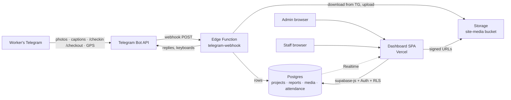

# Site Reporting & Attendance Pipeline

**Plan & Architecture · v2.0 · 2026-08-03**
*(v1 was drafted for a different company's water-utility workflow — superseded in full.)*

Replaces per-project WhatsApp group chats — where one person manually saves images into date folders and anything he misses is lost — with: **Telegram bot** (workers send site photos + info, check in/out with GPS) → **Supabase** (Postgres + Storage, system of record) → **Web dashboard** (real-time feed, powerful filter/search, role-gated: admin vs staff).

---

## 1. The problem, restated

| Today (WhatsApp) | Consequence | Fix in this pipeline |
|---|---|---|
| One group chat per project/site, images buried in chat scroll | Finding "the photos from Site B, March 12" depends on scrolling or on one person's manual archive | Every image is stored against **project + date + worker** the moment it's sent; dashboard filters by any of them |
| One guy manually saves images by date | If he's busy, the record simply doesn't exist | The bot **is** the archive — saving is a side effect of sending, zero extra human effort |
| No attendance trail | No proof who was on site, when | `/checkin` + `/checkout` with one-tap GPS; flagged for admin if in/out locations are ≥ 10 km apart |
| Everyone sees everything, nothing is queryable | — | Dashboard login: **admin** (all data + attendance flags + management) vs **staff** (projects & images, read-only) |

Excel export is explicitly **not** a goal. Findability is the product. (A CSV export of filtered results is a cheap later add-on if ever wanted.)

---

## 2. Decisions & assumptions

| Item | Choice | Notes |
|---|---|---|
| Chat platform | **Telegram** (not WhatsApp) | Bot API is free and full-featured; WhatsApp Business API costs money and can't do custom keyboards well. Workers install Telegram — one-time switch |
| Bot language | English, buttons-first | Same interaction style as before; assumption — flip to bilingual later if workers need it |
| System of record | Supabase Postgres + Storage (`site-media` bucket, private) | Project `automation` (`odsofzzjniafttbdhtye`) already exists and is healthy |
| Bot hosting | Supabase Edge Function, webhook mode, stateless | Conversation state in a `chat_sessions` table |
| Dashboard | Vite + React SPA on Vercel, Supabase Auth | Realtime feed via Supabase Realtime subscriptions |
| Location capture | Telegram `request_location` reply-keyboard button | One tap — the bot cannot silently read GPS; Telegram shows the button, worker taps it, done. Exactly the "permission once per check-in/out" flow you described |
| Off-site rule | Haversine distance(check-in, check-out) **≥ 10 km → flagged** | Stored on the attendance row; surfaces in the admin dashboard until reviewed. Threshold is a config value, not hardcoded |
| Media types | Photos, videos, documents (PDF etc.) | Construction sites send more than photos |
| Cost | $0/month baseline | Free tiers cover it. Watch item: Storage free tier is 1 GB — site photos will exceed that in months; Supabase Pro ($25/mo, 100 GB) is the expected upgrade once real usage starts |

---

## 3. Architecture



Stateless bot, same proven pattern: every Telegram update carries `chat_id`; the function loads that chat's session, applies one transition, replies. Photos are pulled from Telegram's file API and re-uploaded to Storage — Telegram's own file hosting is never relied on (files there can expire).

---

## 4. Data model

```sql
-- Dashboard users (Supabase Auth) ---------------------------------
profiles         (id uuid PK -> auth.users, full_name,
                  role text CHECK (role IN ('admin','staff')))

-- Field workers (Telegram identities; may or may not have a login)
workers          (id, full_name, telegram_user_id UNIQUE, telegram_username,
                  status text CHECK ('pending','active','disabled'),
                  default_project_id fk NULL, created_at)

-- Projects / construction sites -----------------------------------
projects         (id, code text UNIQUE,          -- short code for keyboards, e.g. "SB-01"
                  name, site_address text,
                  site_lat double NULL, site_lng double NULL,   -- optional, enables future geofencing
                  status text CHECK ('active','archived'), created_at)
project_workers  (project_id, worker_id)         -- who's assigned where; drives sticky defaults

-- Site reports (one submission = photos + info) --------------------
reports          (id, project_id fk, worker_id fk,
                  report_date date NOT NULL,     -- defaults to send date, overridable
                  note text,                     -- the "additional info"
                  created_at, updated_at)
report_media     (id, report_id fk, storage_path,
                  media_type text CHECK ('photo','video','document'),
                  telegram_file_id, mime_type, file_size, width, height,
                  media_group_id text NULL,      -- Telegram album id, for aggregation
                  created_at)

-- Attendance -------------------------------------------------------
attendance       (id, worker_id fk, project_id fk NULL,
                  check_in_at timestamptz NOT NULL,
                  in_lat double NOT NULL, in_lng double NOT NULL,   -- no GPS → row cannot exist
                  check_out_at timestamptz NULL, out_lat double NULL, out_lng double NULL,
                  CHECK ((check_out_at IS NULL) = (out_lat IS NULL)),  -- checkout recorded ⇔ GPS present
                  distance_m int NULL,           -- haversine(in, out), set at checkout
                  flags text[] DEFAULT '{}',     -- 'far_apart' (≥ threshold), 'no_checkout', 'double_checkin'
                  review_status text CHECK ('none','pending','cleared') DEFAULT 'none',
                  reviewed_by fk -> profiles NULL, reviewed_at NULL)

-- Config + plumbing -------------------------------------------------
settings         (key text PK, value jsonb)      -- e.g. {'flag_distance_km': 10}
chat_sessions    (chat_id bigint PK, worker_id fk, state text, draft jsonb, updated_at)
```

**Search:** `reports.note` gets a GIN full-text index; filters on project/date/worker are plain indexed columns. "Site B, 12 March, photos by Ali" is one indexed query.

**RLS (default-deny):**

| Table | staff | admin | edge function |
|---|---|---|---|
| projects, reports, report_media | SELECT | ALL | service role (writes) |
| attendance | — (none) | ALL | service role |
| workers, settings, profiles | — | ALL | service role |

Storage bucket is private; the dashboard renders media through short-lived signed URLs, so RLS effectively extends to files.

---

## 5. Telegram bot design

### 5.1 Sending site reports (the WhatsApp replacement)

The core principle: **sending must feel like WhatsApp** — pick project once, then just fire photos.

```
Worker sends photo(s) (album or singles, caption optional)
 ├─ session has an active project (sticky, from last use or default_project_id)
 │   → saved instantly → "✅ 3 photos → SB-01 · today. [Change project] [Add note] [Set date]"
 └─ no active project
     → "Which project?" keyboard of the worker's assigned projects (all active projects behind [More…])
     → then saved as above
```

- **Albums**: Telegram delivers a multi-photo send as separate messages sharing `media_group_id`. The bot buffers them (2 s debounce in the session) and groups them into **one report**.
- **Caption → `note`**, send date → `report_date`. Both editable via the post-save buttons — the default path is zero extra taps.
- `[Set date]` for backfilled photos: quick keyboard *Today / Yesterday / type a date*.
- `/project` — switch the sticky project any time.
- Videos and documents follow the identical flow.

### 5.2 Attendance

```
/checkin
 → reply keyboard with one button: [📍 Share location]  (Telegram's request_location)
 → worker taps → bot records time + GPS
 → if assigned to >1 active project: one-tap project keyboard; else auto
 → "✅ Checked in · 07:42 · SB-01"

/checkout
 → same single location tap
 → bot computes haversine(in, out)
 → "✅ Checked out · 17:05 · on site 9h 23m"
 → if distance ≥ flag_distance_km (default 10): row gets flags += 'far_apart',
   review_status = 'pending' → appears in the admin dashboard's Attendance flags
```

Edge cases handled:
- `/checkin` while already checked in → "You're checked in since 07:42 — check out first?" (`double_checkin` flag if they force a new one).
- No checkout by **midnight** → nightly cron (`pg_cron`) closes the row with `no_checkout` flag → admin queue.
- **Location is mandatory — no GPS, no log.** The `attendance` row is only written at the moment a real location message arrives; `/checkin` or `/checkout` by itself records nothing. If the worker dismisses the keyboard, denies location, or types anything else, the bot re-prompts and the check-in/out simply does not exist until they share. Enforced in the schema too: `in_lat`/`in_lng` are `NOT NULL` — a location-less check-in is unrepresentable.

### 5.3 Registration

Unknown `telegram_user_id` → "Send your full name" → `workers` row created as `pending` → admin approves in the dashboard (and assigns projects). Until approved, the bot politely refuses everything else.

---

## 6. Dashboard

### Shared (admin + staff)
1. **Projects** — card grid (cover = latest photo, counts, last activity). Click →
2. **Project gallery** — photos grouped by date (the manual date-folder system, automated), with filters: **date range · worker · media type · text search in notes**. Lightbox viewer, per-image download, multi-select download. New reports appear live (Realtime subscription).
3. **Global search** — same filters across all projects at once.

### Admin only
4. **Attendance** — per-day table: worker, project, in/out times, hours, map pin links. **Flags queue** on top: `far_apart` (with the two points on a map and the distance), `no_checkout`, `double_checkin` — each with *Clear* / *Note* actions (`review_status` → `cleared`).
5. **Workers** — approve pending Telegram registrations, assign projects, disable leavers.
6. **Projects admin** — create/archive projects, set site address (+ optional coordinates for future geofencing).
7. **Users** — invite dashboard accounts, set `admin`/`staff` role.
8. **Settings** — flag distance threshold, etc.

Staff literally cannot query attendance — blocked at the RLS layer, not just hidden in the UI.

---

## 7. Security

- Bot token + service-role key only in Edge Function secrets; webhook validated via `X-Telegram-Bot-Api-Secret-Token`.
- Only `active` workers can submit; everyone else lands in registration.
- Dashboard: Supabase Auth (email/password, invite-only — no public signup). Role lives in `profiles`, enforced by RLS policies, mirrored in the UI.
- Private storage bucket + signed URLs (short expiry).
- GPS points are sensitive: attendance is admin-only end to end, and coordinates never appear in staff-visible views.

---

## 8. Build phases & success criteria

| Phase | Deliverable | Done when |
|---|---|---|
| **0. Setup** | Bot via @BotFather, webhook wired to `automation` project, repo scaffold (`/supabase`, `/dashboard`) | Bot echoes a message in Telegram |
| **1. Schema** | All migrations (§4), RLS policies, `site-media` bucket, seed 1–2 test projects | Policies verified with anon/staff/admin test tokens |
| **2. Media flow** | Registration + photo/album/video/document intake with sticky project, notes, date override | A 5-photo album sent from a phone lands as one report with 5 media rows and files in Storage |
| **3. Attendance** | `/checkin` `/checkout` with GPS, distance calc, flagging, midnight cron | A real check-in/out pair ≥ 10 km apart produces a `far_apart` flag row |
| **4. Dashboard** | Auth + roles, project galleries with filters/search, realtime, attendance + flags queue, admin management | Staff login sees galleries but gets zero rows from attendance; admin clears a flag; a filter for "project X + last week + worker Y" returns in <1 s |
| **5. Pilot → rollout** | One project's crew live for a week; tune friction; then all sites | One week where photos are findable by date/project without anyone manually saving anything, and every workday has an attendance pair |

Each phase gates on its verification before the next starts.

---

## 9. Risks & mitigations

| Risk | Mitigation |
|---|---|
| Workers resist switching WhatsApp → Telegram | The send-photos flow is deliberately identical to WhatsApp muscle memory (open chat, send pics). Pilot with one friendly crew first |
| GPS spoofing / sharing a saved location | Telegram's one-tap button sends live device GPS, not a pin-drop, which raises the bar; the 10 km in/out rule catches gross violations. True anti-spoof is out of scope — this is a deterrent + audit trail, not forensics |
| Storage growth (site photos are heavy) | Photos stored at Telegram's compressed resolution by default (~100–300 KB each). 1 GB free tier ≈ months of runway; upgrade path is a toggle, not a redesign |
| Album debounce misses a photo on a slow connection | Late album parts attach to the existing report by `media_group_id` regardless of timing |
| Worker forgets to check out | Nightly cron flags it instead of leaving silent half-rows |
| "Very far" threshold wrong in practice | It's a `settings` row the admin can change, not code |

---

## 10. Open items

- ~~Bot handle~~ — **resolved**: bot created, `@CLAutomationBot` (t.me/CLAutomationBot). Token held by the owner; goes into Edge Function secrets at Phase 0, never into code or the repo.
- **Initial project/site list** (names + codes) and worker names — can seed with placeholders and let the admin fill in via dashboard.
- Whether staff dashboard users should also see **who** uploaded each photo (currently: yes, worker name shows; GPS never).
- Site coordinates per project — optional now; enables a stronger future rule ("check-in must be within X km of the site") on top of the in/out-distance rule.
